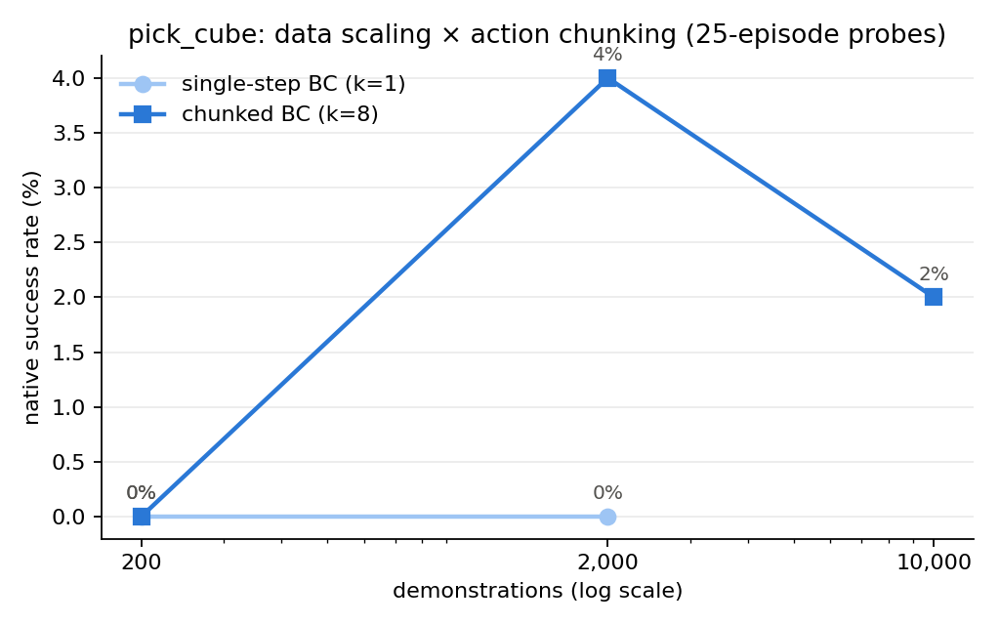
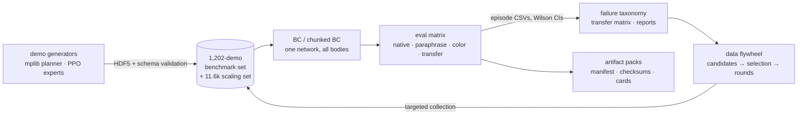

# xembench — X-Embodiment Language-Grounded Manipulation Benchmark

[](https://github.com/Janga786/xembench/actions/workflows/ci.yml)
[](https://github.com/Janga786/xembench/releases)
[](LICENSE)


**One language-conditioned policy network. One canonical 21-dim action
interface. Two robot bodies — a Franka Panda arm and a Unitree G1 humanoid.
xembench measures exactly how much manipulation skill survives the swap,
and when it doesn't, its failure taxonomy and data flywheel say why.**

Built on ManiSkill3 + a single RTX 5090. The design, experiments, analysis,
and conclusions are mine; AI coding agents assisted substantial parts of the
implementation and campaign operations (see Provenance at the bottom). Every
number below is recorded with its checkpoint, config snapshot, and git SHA in
the run's artifact pack; the campaign reports in `reports/` summarize them
(packs are regenerable and not committed — available on request).

## Results (v2 matrix — 73 cells, 6,550 episodes, 3 seeds, Wilson CIs)

| Task | Embodiment | BC native success | Held-out paraphrase | Notes |
|---|---|---:|---:|---|
| push_t | Panda (stick) | **45.7%** | 46.3% | language grounding robust |
| transport_box | **G1 humanoid** | **18.8%** | 21.0% | learned from 8.5%-stochastic expert demos |
| pull_tool | Panda | 1.3% → **14.7%** | 15.3% | chunked BC, matrix-grade (3 seeds × 100 eps/cell) |
| pick_cube | Panda | 0% | 0% | the open problem (see study below) |
| stack_cube | Panda | 0% | 0% | " |
| apple_bowl | G1 humanoid | 0% | 0% | thin-demo imitation failure (finding 3) |

Cross-embodiment transfer cells are all ≈0% at these baselines — the
benchmark's headline metric is *waiting for a policy class strong enough
to cross it*, and everything needed to measure that day is in place.

## The precision-manipulation study (an honest negative result)

Half the tasks sat at 0% with a single failure label: timeout. We proved
the pipeline innocent first — **open-loop replay of ground-truth
demonstration actions through the identical adapter→env path succeeds
5/5** — then systematically attacked the policy:



| Intervention (pick_cube, 25–50-ep probes) | Result |
|---|---:|
| single-step BC, 200 demos (baseline) | 0% |
| + 10× demonstrations (2,000) | 0% |
| + action chunking k=16 (Zhao et al. 2023) | 0% |
| + temporal ensembling | 0% |
| **action chunking k=8 + 10× demos** | **4%** (probe) → 0.2% matrix |
| + gripper binarization / receding horizon | 4% |
| + ResNet-18 encoder (4× params) | 0% (overfits) |
| + 50× demonstrations (10,000) | 2% (flat) |
| dense-reward visual PPO fine-tune | 0.1% (KL-unstable) |

The same recipe promoted to matrix scale (3 seeds × 100 episodes/cell)
lifted **pull_tool from 1.3% to 14.7%** — tool use hooks and drags, no
precision grasp required — while pick/stack stayed ≈0% (the 4% probe was
single-seed noise). Diagnosis (instrumented rollouts): reaching is accurate
to 2–3 cm and the gripper commits fully — failures concentrate in
**last-inch grasp conversion**, and neither data volume nor execution
strategy moves it.
The bottleneck is the policy class: single-frame MLP-head BC at 128 px,
versus the transformer sequence models (ACT, diffusion policies) that
solve this regime elsewhere. That gap is now this benchmark's central,
*quantified* open problem — and ~12,800 validated demonstrations (1,202
benchmark + 11.6k scaling) plus the per-task collection infrastructure are
staged for whoever closes it.

## Physical AI Data Flywheel (first real round, executed)

`xembench.flywheel` closes the loop eval failures → typed candidate
requests → budgeted selection → validated collection → retraining →
CI-gated round comparison. Round 1 (targeted vs random arms, 50-episode
budget): **an informative null** — deltas inside CIs, plus a methodology
finding (single-seed vs pooled-baseline comparisons fabricate ±5–9 pt
phantom swings; seed-matched CSVs are now the standard). Round 1's
recommendation — pair data with a compounding-error intervention — became
the study above. Packs are regenerable from the committed configs and are
not stored in-repo (`artifacts/releases/` is gitignored); seed-matched CSVs
are summarized in `reports/`.

## What's inside



- **Canonical action space** (21-dim) + thin per-robot adapters with
  round-trip invariants and live-env joint-order validation — transfer is
  a pure adapter swap at eval time.
- **Language stack**: leak-free train/held-out paraphrase split, disjoint
  train/unseen color sets, both enforced by tests.
- **Provenance discipline**: every run directory carries its config + git
  SHA; artifact packs bundle metrics, figures, checksums, dataset/model
  cards; videos re-run exact episode seeds (`scripts/record_rollouts.py`).
- 198 tests (unit + sim integration), CI on pure-unit subset.

## Battle scars (selected findings, from the run logs — not committed, available on request)

1. **Eval horizons were impossible by construction** — frozen 50-step caps
   vs 66–105-step demos; measured as 0%/100%-timeout, fixed to demo-p95,
   re-run.
2. **PhysX collision-stack demand grows as the policy learns contact**
   (8M → 150M bytes; default 4M silently drops contacts at 2048 envs).
3. **A success metric that read 100% for a bad policy** — successes
   terminate early, failures truncate together; windows without a
   truncation step contain only successes. Fixed with rolling episode
   pooling.
4. **Staged reward bonuses detonate PPO's KL** exactly when success
   emerges (approx_kl 28.5 observed); target-KL epoch cutoff added.
5. **Stochastic-expert demos imitate better than lucky-deterministic
   ones** (transport 18.8% from an 8.5% expert vs apple 0% from a 6% one).
6. **The G1's hand joints are URDF-mirrored** — the frozen constants
   opened one hand while closing the other; caught by a joint-sweep
   diagnostic before it corrupted every canonical demo.

Full story: [reports/phase_b_campaign_report.md](reports/phase_b_campaign_report.md) ·
[reports/b0_linux_prep_report.md](reports/b0_linux_prep_report.md)

## Quickstart

```bash
# Linux + NVIDIA (tested: RTX 5090 / cu128)
./scripts/setup_linux.sh        # uv env, CUDA/Vulkan checks, sim FPS bench
make smoke                      # full pipeline gate (~10 min)
make phase-b-help               # the ordered training runbook
make flywheel-help              # the data-flywheel CLI

# macOS (development / smoke only)
./scripts/setup_mac.sh && make smoke
```

Common entry points: `make test` / `make test-sim` / `make check` ·
train `uv run python -m xembench.scripts.train_bc --config configs/presets/bc_train_full.yaml --set task=pick_cube_arm --set chunk=8` ·
evaluate `uv run python -m xembench.scripts.evaluate --config configs/presets/full_eval_matrix.yaml`.
Every script takes `--seed` and `--set key=value`; presets live in
`configs/presets/`.

## Repository structure

```
src/xembench/
  constants.py     canonical action/proprio layout, pinned joint orders (source of truth)
  embodiment/      EmbodimentAdapter base + panda/panda_stick/g1 + registry
  envs/            factory, UnifiedObsWrapper, custom *Lang-v1 envs
  language/        templates, paraphrase split, tokenizer, parser
  data/            HDF5 schema/writer/validator, DemoDataset (chunked), HF converter
  experts/         motion-planning collector (mplib), PPO-expert loader
  models/          encoders, BCPolicy (+action chunking), actor-critics
  training/        BC trainer, CleanRL PPO (target-KL, warm start, env_kwargs)
  eval/            episode runner (chunk queues/ensembling, Wilson CIs), matrix
  analysis/        failure taxonomy, episode CSVs, transfer matrix, video index
  flywheel/        schemas, dataset index/validation/cards, candidates,
                   selection strategies, round comparison, flywheel packs
configs/           tasks.yaml registry (horizons = demo p95), presets/
docs/              architecture, canonical space, plans, runbooks, flywheel specs
reports/           campaign reports + generated summaries
artifacts/         packs, videos (INDEX.md tracked), media
```

## Interpreting results

`data/results/eval.csv`: `task` = training task, `eval_task` = evaluation
task; rows where they differ are transfer cells. Headline metric:
**transfer drop** `SR_native − SR_transfer` on pick_cube↔apple_bowl and
stack_cube↔transport_box; paraphrase and unseen-color deltas are the
secondary axes. Definitions: [docs/metrics.md](docs/metrics.md).

## Limitations

Hand-designed canonical interface (kinematic aliasing documented);
analogous rather than identical transfer pairs; two embodiments;
128-px closed-vocabulary sim-only setting; BC baselines below the
transfer-measurement threshold on precision tasks (the study above) —
transformer-class baselines are the designed next step, and the adapter
seam is built for more bodies (Isaac Lab / LeRobot / hardware).

## Citation

```bibtex
@misc{xembench2026,
  title  = {xembench: An X-Embodiment Language-Grounded Manipulation Benchmark},
  author = {Jangara Bliss},
  year   = {2026},
  note   = {https://github.com/Janga786/xembench}
}
```

## Provenance & AI assistance

The benchmark design, task and action-space choices, experiment designs, the
decisions about what to run and what to conclude, and every claim above are
mine. Substantial parts of the implementation and the campaign's operations
were carried out with AI coding agents under my direction, matching the
attribution on my portfolio. Simulation, tasks, and planners build on the
upstream systems credited below.

Built on [ManiSkill3](https://github.com/haosulab/ManiSkill) (Mu et al.);
action chunking follows Zhao et al., *Learning Fine-Grained Bimanual
Manipulation with Low-Cost Hardware* (ACT), 2023.
