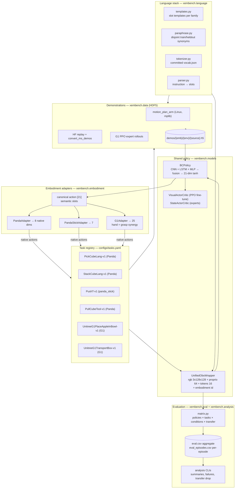

# Architecture

xembench turns embodiment transfer into a measurable systems problem. It does
not claim to solve general robot intelligence; it asks a narrower question:
**when language, task structure, and policy architecture are shared, how much
performance survives a change of robot body — and where exactly does transfer
fail?**

Everything in the design serves that question: one policy network, one
canonical action/observation interface, one instruction distribution — and
thin, auditable per-robot adapters that are the *only* embodiment-specific
component at evaluation time.

## System diagram

## Data flow, end to end

1. **Task registry** (`configs/tasks.yaml`) is the single source of truth:
   env id, embodiment, camera, instruction family, static template slots,
   episode length, demo source, and the two cross-embodiment transfer pairs.
2. **Instructions**: at each episode start, `UnifiedObsWrapper` renders the
   task family's template with per-episode slots (custom Lang envs expose
   `language_slots()`; fixed-scene stock envs use static slots from the
   registry), optionally paraphrases with the train or heldout synonym
   table, and tokenizes against the committed vocab.
3. **Demonstrations** from three sources are normalized into one HDF5 schema
   (`xembench.data.schema`): per-episode RGB, canonical proprio, canonical +
   native actions, instruction text, success, seed.
4. **BC training** (`training/bc_trainer.py`) fits the shared `BCPolicy` with
   a masked SmoothL1 loss — masked because each embodiment only *owns* a
   subset of the 21 canonical dims.
5. **PPO** (`training/ppo.py`, CleanRL-style on torch-native vectorized envs):
   mode 1 trains flat-state dense-reward experts (the G1 demo source);
   mode 2 fine-tunes a BC checkpoint with sparse reward, frozen vision, and
   an L2 pull toward the frozen BC actor.
6. **Evaluation** (`eval/matrix.py`) runs the grid and writes both an
   aggregate CSV row per cell and per-episode records; `eval/report.py`
   prints the human-readable tables; `xembench.analysis` computes failure
   breakdowns and transfer-drop matrices from the episode CSV.

## The canonical interface (the core contribution)

- **Action**: 21 dims with fixed semantic slots (right arm ×7, right gripper
  ×1, left arm ×7, left gripper ×1, torso ×3, head ×2). Detailed in
  [canonical_action_space.md](canonical_action_space.md).
- **Proprio**: 64 dims — qpos then qvel laid out to mirror the action slots,
  zero-padded, with a validity mask that doubles as an embodiment cue.
- **Control mode**: `pd_joint_delta_pos` on every robot — the only mode both
  the Panda and the G1 upper body support, and ManiSkill normalizes it to
  [-1, 1] on both, so canonical actions are well-scaled across embodiments
  by construction.

**Zero-shot transfer = same trained network, swap the adapter.** The policy
is never told it changed bodies except through the proprio mask, the
embodiment one-hot, and what the camera sees.

## What is shared vs. embodiment-specific

| Shared across embodiments | Embodiment-specific |
|---|---|
| `BCPolicy` weights and architecture | `EmbodimentAdapter` subclass (~40 lines each) |
| Canonical action/proprio layout | native action dim + joint-slot index maps |
| Instruction templates, paraphrase split, vocab | camera choice (third-person vs egocentric head cam) |
| HDF5 demo schema and dataset code | scripted demo source (motion planning vs PPO expert) |
| BC/PPO trainers, eval runner, metrics | native controller layout pinned in `constants.py` |

The deliberate asymmetries — camera viewpoint, arm DOF (7 vs 5), gripper
mechanism (parallel jaw vs 7-joint hand collapsed to a grasp synergy) — are
part of what the benchmark measures, not confounds to be engineered away.
They are documented as expected sources of transfer drop.

## Module map

| Path | Responsibility |
|---|---|
| `src/xembench/constants.py` | canonical layout, pinned native joint orders, color sets — the single source of truth |
| `src/xembench/embodiment/` | adapter base + Panda/panda_stick/G1, registry |
| `src/xembench/envs/` | env factory, `UnifiedObsWrapper`, custom Lang env subclasses |
| `src/xembench/language/` | templates, paraphrase split, tokenizer (+ vocab.json), parser |
| `src/xembench/data/` | HDF5 schema/writer/validator, torch dataset, HF demo converter |
| `src/xembench/experts/` | motion-planning collector (Linux), PPO-expert loader |
| `src/xembench/models/` | encoders, BCPolicy, actor-critics, diffusion stub |
| `src/xembench/training/` | BC trainer, CleanRL PPO (both modes) |
| `src/xembench/eval/` | episode runner (Wilson CIs), matrix, aggregate report |
| `src/xembench/analysis/` | failure taxonomy, episode CSV tools, transfer-drop matrix |
| `src/xembench/scripts/` | CLI entrypoints (`python -m xembench.scripts.<name>`) |
| `configs/` | task registry + per-stage YAML defaults + `presets/` |
| `tests/` | fast sim-free suite + `-m sim` integration suite |

## Design decisions worth knowing

- **Config system**: plain YAML + dotted `--set key=value` overrides
  (`utils/config.py`). Deliberately not Hydra — the surface is small and the
  overrides compose with shell history and Makefiles.
- **Paths**: SAPIEN chdirs during shader compilation, so anything that
  outlives env creation goes through `resolve_path()` (anchored at repo
  root). Tests enforce this stays true.
- **Duck-typed obs wrapper**: `UnifiedObsWrapper` is not a `gym.Wrapper`
  because it must wrap both plain envs and `ManiSkillVectorEnv` (a
  `VectorEnv`, which `gym.Wrapper` rejects).
- **No mocks**: even the Mac smoke path runs real ManiSkill physics and
  rendering (CPU backend, MoltenVK) so the repo transfers to Linux with zero
  code changes.
